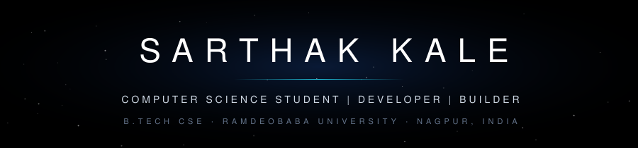
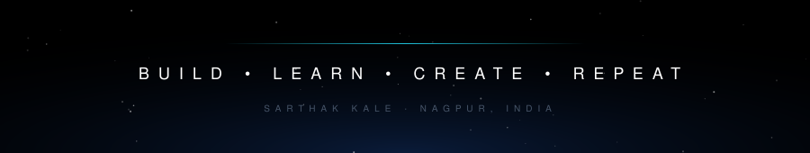

  

  

  
  
  
  
  

 

  I'm a computer science student at <b>Ramdeobaba University, Nagpur</b>, 
  building full-stack products where clean interfaces meet solid backends.  
  <i>"I don't wait for the future. I build things that could become it."</i>

 

<table align="center">
  <tr>
    <td width="50%" valign="top">
      <h3>Happenins</h3>
      Event discovery and ticketing platform for Nagpur and Pune.  
      
      
    </td>
    <td width="50%" valign="top">
      <h3>FocusFlow</h3>
      Productivity platform built to protect your attention.  
      
      
    </td>
  </tr>
  <tr>
    <td width="50%" valign="top">
      <h3>Skylight</h3>
      Aviation tracking with a clean, real-time interface.  
      
      
    </td>
    <td width="50%" valign="top">
      <h3>Vault Q</h3>
      Money management SaaS for tracking and understanding your finances.  
      
      
    </td>
  </tr>
  <tr>
    <td colspan="2" valign="top" align="center">
      <h3>Memory Ticket</h3>
      Digital memory organizer that turns moments into collectible tickets.  
      
      
    </td>
  </tr>
</table>

<!-- Link each project: wrap its <h3> in <a href="https://github.com/sarthak-kale/REPO-NAME"> -->

 

  
  
  
  
  
  
  
  
  
  
  
  

 

  Java DSA &nbsp;·&nbsp; Data Structures &amp; Algorithms &nbsp;·&nbsp; Full-Stack Development &nbsp;·&nbsp; Backend Engineering

 

  
  

  

  

 

  <a href="mailto:sarthakkale2103@gmail.com">sarthakkale2103@gmail.com</a> &nbsp;·&nbsp;
  <a href="https://instagram.com/_sarthakkale">Instagram</a> &nbsp;·&nbsp;
  <a href="https://threads.net/@_sarthakkale">Threads</a>

 

