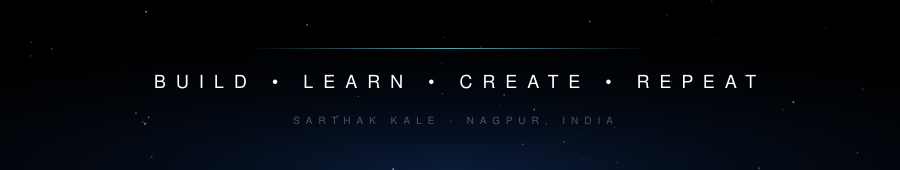

 

First-year B.Tech Computer Science &amp; Engineering student at <b>Ramdeobaba University, Nagpur</b>, 
building production-minded software while mastering the fundamentals underneath it.

Java is my foundation. The full stack is where I put it to work. 
I'm drawn to products where clean interface design meets solid engineering: 
SaaS platforms, AI-assisted tools, and anything that makes complex systems feel simple.

<table>
  <tr>
    <td align="center" width="260"><b>EDUCATION</b>  B.Tech, Computer Science &amp; Engineering Ramdeobaba University</td>
    <td align="center" width="260"><b>CURRENT LEVEL</b>  First year Learning in public, shipping alongside</td>
    <td align="center" width="260"><b>INTERESTS</b>  Full-Stack &amp; SaaS AI · UI/UX · DSA Software Engineering</td>
  </tr>
</table>

Right now: sharpening core Java and data structures, while building real products to put the theory under load.

 

  
   
  

 

<table>
  <tr>
    <td width="420" valign="top">
      <h3><a href="https://github.com/YOUR_USERNAME/focusflow">FocusFlow</a></h3>
      <b>PRODUCTIVITY PLATFORM</b>
      
A focused workspace for planning your day, protecting your attention, and finishing what you start.

    </td>
    <td width="420" valign="top">
      <h3><a href="https://happenins.co">Happenins</a></h3>
      <b>EVENT DISCOVERY &amp; TICKETING</b>
      
Discover, book and experience local events across Nagpur and Pune, with Razorpay payments and QR check-in.

    </td>
  </tr>
  <tr>
    <td width="420" valign="top">
      <h3><a href="https://github.com/YOUR_USERNAME/skylight">Skylight</a></h3>
      <b>AVIATION TRACKING PLATFORM</b>
      
Real-time aircraft tracking from live ADS-B data, layered with astronomy overlays.

    </td>
    <td width="420" valign="top">
      <h3><a href="https://github.com/YOUR_USERNAME/vault-q">Vault Q</a></h3>
      <b>MONEY MANAGEMENT SAAS</b>
      
One calm place to track spending, plan budgets and understand where your money goes.

    </td>
  </tr>
  <tr>
    <td colspan="2" align="center" valign="top">
      <h3><a href="https://github.com/YOUR_USERNAME/memory-ticket">Memory Ticket</a></h3>
      <b>DIGITAL MEMORY ORGANIZER</b>
      
Turn moments into collectible tickets, organized, searchable and yours to revisit.

    </td>
  </tr>
</table>

 

  
  &nbsp;
  

  

  

 

<table>
  <tr>
    <td align="center" width="210" valign="top"><b>Java DSA</b>  Core structures and patterns, implemented from scratch in Java</td>
    <td align="center" width="210" valign="top"><b>Data Structures &amp; Algorithms</b>  Problem solving, complexity analysis, interview-grade thinking</td>
    <td align="center" width="210" valign="top"><b>Full-Stack Development</b>  React and Next.js frontends wired to real, shipped backends</td>
    <td align="center" width="210" valign="top"><b>Backend Engineering</b>  APIs, databases, auth and systems that hold up in production</td>
  </tr>
</table>

 

  
  
  

 

